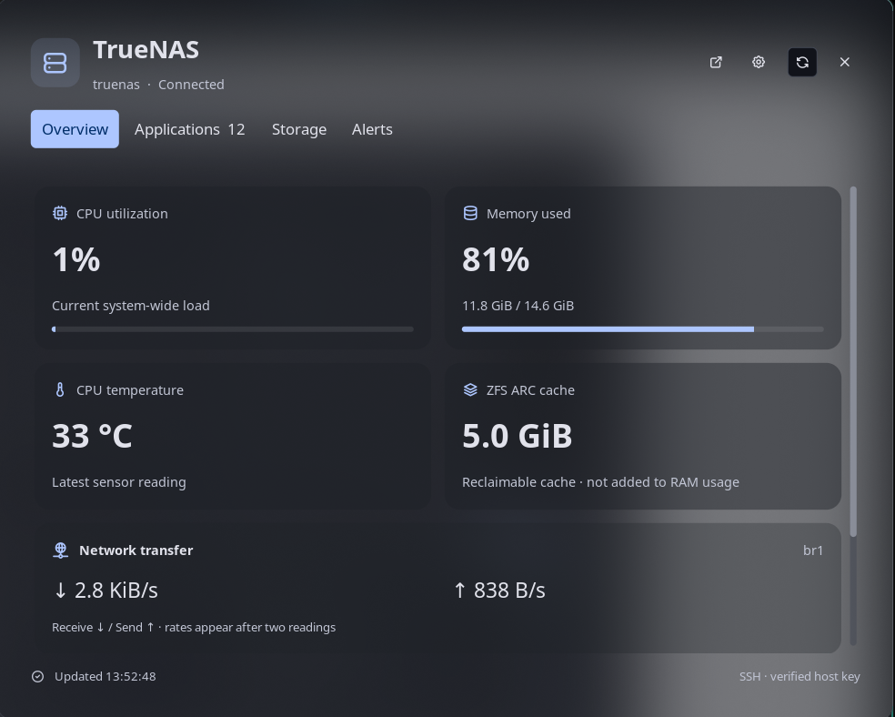
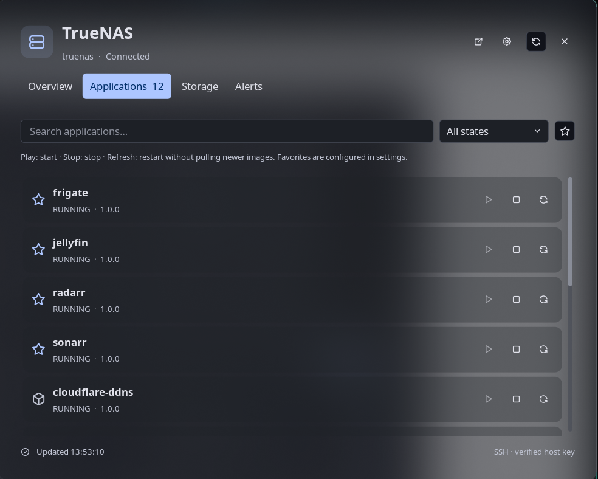
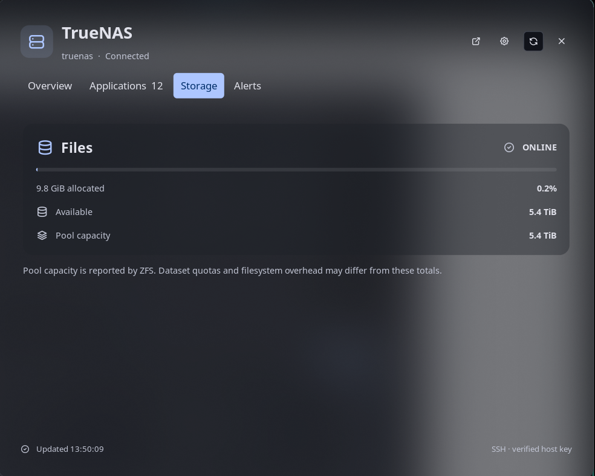
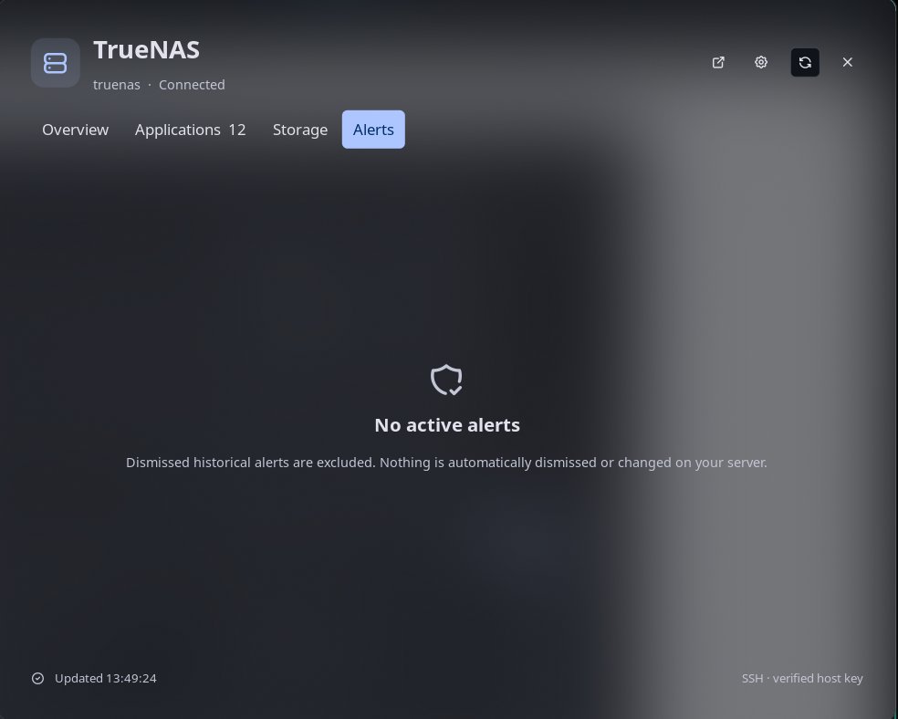

# TrueNAS Command Center for Noctalia

A native top-bar plugin for **Noctalia 5.3+**: your server's vital signs, ZFS storage health, active alerts, and application controls in one theme-aware panel.

Built for the current **Luau/native** Noctalia plugin system. This is **not** a legacy Quickshell/QML plugin.

## Features

- **At a glance:** server icon with CPU, memory, running-app count, server name, or icon-only display.
- **Overview:** CPU utilization, RAM used/total, CPU temperature, ZFS ARC, uptime, and network receive/send rates.
- **Applications:** search, state filters, configured favorites, hidden apps, web shortcuts, and Start / Stop / Restart controls.
- **Storage:** ZFS pool state, allocated/free capacity, and labeled utilization meters.
- **Alerts:** active TrueNAS alerts; dismissed historical alerts are excluded.
- **Native settings:** SSH connection, refresh cadence, timeouts, confirmations, read-only mode, appearance, favorites, notifications, and optional cards.
- **Resilience:** background requests, last-good readings with stale/offline state, backoff, and locked controls when a mutation has an uncertain outcome.

The interface uses Noctalia's semantic palette, so it follows your desktop theme rather than imposing a separate color scheme. No browser, remote agent, extra Python packages, or API key is required.

## Screenshots

Actual native panels on Noctalia 5.3, using the desktop's theme and live read-only server data:



<details>
<summary>Applications, storage, and alerts</summary>







</details>

## Requirements

**Desktop:** Noctalia 5.3+ with plugin API 24, Python 3.11+, OpenSSH, and `xdg-open` for web shortcuts.

**Server:** TrueNAS SCALE with `midclt` and Python 3.11+. Read-only collection was verified against **TrueNAS 25.10.7**. Older CORE/Kubernetes-app versions are not supported.

Your desktop must already be able to authenticate with a key or SSH agent:

```sh
ssh -o BatchMode=yes -o StrictHostKeyChecking=yes root@192.168.99.114 'midclt call system.version'
```

The initial host-key trust decision must be made outside the plugin, after verifying the server's fingerprint through a trusted channel. The plugin never accepts unknown or changed keys automatically and never prompts for passwords. Unlock passphrase-protected keys in your SSH agent first.

Defaults are preconfigured for `root@192.168.99.114:22`, management interface `br1`, and `http://192.168.99.114`. These are editable, not hard-coded transport requirements.

## Install

Clone or keep this repository at a stable local path. Preview first:

```sh
python3 -I tools/install.py
```

Then apply the local integration:

```sh
python3 -I tools/install.py --apply
```

The installer registers the repository as a local path source, enables `PedroRBC/truenas`, and adds one `truenas` widget to the default bar. It backs up changed configuration and preserves existing widgets, sources, monitor overrides, and unrelated settings. It does not restart your shell or write anything to the NAS.

You can also register a path source using Noctalia's plugin-source UI: the source directory is the **repository root**, which contains the `truenas/` plugin directory. Enable **TrueNAS Command Center**, then add its **status** widget through the bar editor.

### Open and configure

- **Left-click** the widget: open the command center, including when disconnected.
- **Right-click:** refresh the server inventory.
- **Middle-click:** Noctalia's widget settings shortcut.
- **Panel gear:** full plugin settings.

```sh
noctalia msg panel-open PedroRBC/truenas:manager
noctalia msg settings-open-plugin PedroRBC/truenas
noctalia msg plugin PedroRBC/truenas:backend all refresh
```

Custom Noctalia gesture bindings can override the default widget callbacks.

### Uninstall

```sh
python3 -I tools/install.py --uninstall       # preview
python3 -I tools/install.py --uninstall --apply
```

Only this plugin's registration/widget entries are removed. Existing user settings and the repository remain intact. Operation journals in Noctalia's private plugin data directory are retained; do not delete an unresolved journal merely to unlock controls.

## Settings guide

| Area | Options |
| --- | --- |
| Connection | Display name, SSH host/user/port, optional identity file, web interface URL |
| Telemetry | Selected network interface, live refresh interval, inventory interval, request timeout, stale threshold |
| Management | Read-only mode, Stop/Restart confirmations, operation timeout, completion notifications |
| Applications | Comma-separated exact favorite names and hidden names |
| Appearance | Bar metric/accent, temperature/network/ARC card visibility |

Live statistics refresh every **10 seconds**, inventory every **60 seconds** by default. Opening the panel or manually refreshing requests fresh inventory. Failed connections back off, capped at two minutes. Choose a stale threshold longer than the live refresh interval. Configuring another host also requires updating the separate web UI URL and network interface.

Applications, pools, and alerts track their own last successful inventory readings. A failed section keeps its cached values with a persistent **not current** warning, even when live statistics recover. A section that has never loaded is **unavailable**, not an empty healthy result. Failed or expired application inventory disables app controls.

Network rates need two valid counter samples. A missing interface, first sample, reset, or unavailable sensor displays **—**, not a misleading zero. Choose one bridge **or** its physical member—not both. Memory is total minus available; ARC is displayed separately and is not added a second time.

## App operation safety

Start, Stop, and Restart only occur after an explicit UI action. **Stop and Restart require confirmation by default.** Read-only mode disables all mutation controls.

A Restart is deliberately:

1. Validate the app against current TrueNAS inventory.
2. Submit `app.stop` and wait for that specific middleware job to succeed.
3. Submit `app.start` and wait for its job to succeed.

It **does not call `app.redeploy`**, pull newer images, or change app configuration. If the stop fails or its result is unknown, the start is not submitted automatically. If the start fails after a successful stop, the app may remain stopped and the error is reported.

An SSH timeout does **not** cancel a server-side job. A private local operation journal prevents blind retries. The panel's **Check outcome** action reconciles through read-only queries; no follow-up mutation is automatically executed. When an outcome cannot be established, inspect TrueNAS job records before attempting recovery. If SSH disconnects before a job ID is captured, automatic reconciliation is unavailable and controls intentionally remain locked. App state alone cannot prove that a delayed job will not still execute. There is no force-unlock control: an operator must establish the exact job outcome before any manual journal repair; do not delete the journal merely to retry.

The configured SSH account must be authorized to call the relevant middleware methods. **Root grants full server privileges**; the plugin's operation allowlist is not a substitute for server-side account isolation. Hidden apps are a display preference, not access control. The plugin never saves passwords or private-key contents, and it never disables SSH host verification.

The only server mutations implemented are individual app start/stop/restart. There are no reboot, shutdown, update, install, remove, pool-edit, or arbitrary-command controls.

## Development and verification

```sh
python3 -I -m unittest discover -s tests -v
noctalia plugins lint truenas
```

Read-only bridge smoke test, independent of the UI:

```sh
python3 -I truenas/scripts/truenas_bridge.py \
  --host 192.168.99.114 --user root --port 22 --identity '' \
  --interface br1 --timeout 20 --state-dir /tmp/truenas-command-center-check inventory
```

The helper prints normalized JSON, not raw application configuration, environment variables, or volume mounts. Real app-mutation testing is intentionally excluded; automated tests mock the transport/jobs.

Verification covers backend normalization and job handling, installer ownership/concurrency, packaging/settings/translations, and mocked panel/service behavior. The optional Lua harnesses lower a few Luau syntax forms to exercise logic; they are **not Luau compilers**. Native compilation/loading and the four dashboard layouts were checked in the running Noctalia shell. The settings schema was linted and its open command checked, but every generated setting was not individually exercised in the GUI.

Useful native UI diagnostics:

```sh
noctalia msg plugin PedroRBC/truenas:manager all tab apps
noctalia msg plugin PedroRBC/truenas:manager all tab storage
noctalia msg plugin PedroRBC/truenas:manager all tab alerts
```

Luau changes hot-reload. Manifest changes require a configuration reload. Runtime failures are recorded in `~/.cache/noctalia/noctalia.log`. The user-authored config is `~/.config/noctalia/config.toml`; GUI-managed overrides live in `~/.local/state/noctalia/settings.toml` and can take precedence.

### Troubleshooting

- **Authentication/host-key error:** run the exact read-only SSH command above from your desktop session. Check the agent, identity path, port, and verified `known_hosts` entry. Never work around this by disabling host checking.
- **Stats but no app/pool data:** wait for inventory or press Refresh; inspect partial-collection warnings.
- **Controls disabled:** check read-only mode, stale/disconnected data, an in-flight request, or an unresolved operation journal. App controls also depend on the reported app state.
- **No network rate:** check the server interface name and wait for two readings.
- **No app web shortcut:** shortcuts only appear when TrueNAS reports a usable HTTP(S) portal. The verified server currently reports empty portal mappings for its apps; the plugin does not guess ports or inspect secrets to invent URLs.
- **Plugin not shown:** confirm the path source points to the repository root, the plugin is enabled, and the widget is present on the intended bar/monitor. Do not install directly into Noctalia's managed materialization cache.

## Layout

```text
truenas/
  plugin.toml               Native entries and settings schema
  widget.luau               Top-bar status
  panel.luau                Command center
  service.luau              Polling and action coordinator
  format.luau               Shared formatting and validation
  scripts/truenas_bridge.py Local SSH transport / operation journal
  scripts/remote.py         Fixed, installation-free remote collector
  translations/en.json      Interface and settings text
tools/install.py            Reversible local registration
tests/                      Mocked backend, installer and packaging tests
```

[Noctalia native plugin documentation](https://docs.noctalia.dev/noctalia/plugins/development/)
